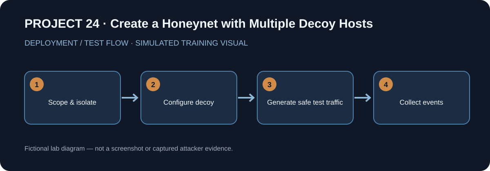
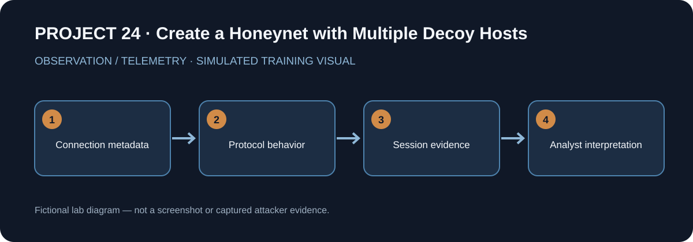
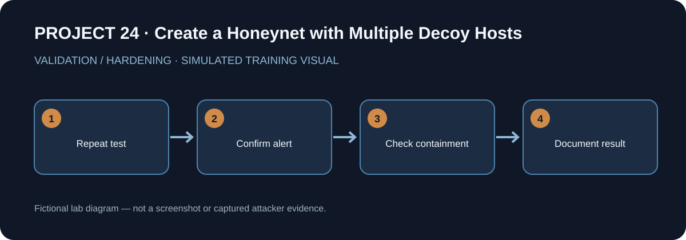

# 24. Create a Honeynet with Multiple Decoy Hosts

**Level:** Intermediate · **Track:** Honeynets

## Objective
Connect distinct decoy systems in a dedicated virtual segment and correlate their events centrally.

## Scope and safety
- Use only a lab you own or have explicit written authorization to test.
- Use synthetic hosts, identities, files, messages, and credentials. Never place production secrets or personal data in a decoy.
- Keep the sensor isolated from production. Deny unnecessary outbound traffic and prevent the honeypot from being used to pivot or attack third parties.
- High-interaction and malware-related work belongs on disposable, snapshotted systems with strict network controls and a documented shutdown procedure.

## Prerequisites
- A hypervisor or isolated cloud test environment; a dedicated management workstation.
- Linux administration and basic TCP/IP knowledge.
- A log directory or collector with synchronized clocks and sufficient disk space.
- A written lab scope, network diagram, and rollback snapshot.

## Lab design
1. Create a dedicated honeypot subnet or isolated virtual network. Separate management access from decoy-facing interfaces.
2. Configure firewall policy as deny-by-default. Permit only the specific inbound test services and the minimum outbound log-forwarding path, if required.
3. Use a fresh VM snapshot and synthetic host identity. Do not bridge the decoy into a home or business LAN.
4. Enable structured logging, timestamps, sensor-health monitoring, and log rotation before exposing the service to test traffic.
5. Document the listener ports, software versions, configuration files, and authorized test source addresses.

## Procedure
1. **Define the question.** Record what behavior this project should reveal and which telemetry will answer it.
2. **Deploy the decoy.** Install or configure the named service/platform in the isolated lab. Bind only the intended interface and verify the listener locally.
3. **Harden containment.** Apply host firewall rules, disable unnecessary services, restrict privileges, and verify outbound restrictions from the decoy.
4. **Generate controlled activity.** From a separate lab client, perform benign connection, discovery, and protocol interactions that are explicitly in scope. Avoid real credential submission, destructive commands, malware execution, or public scanning.
5. **Collect evidence.** Export event records, timestamps, configuration excerpts, service status, and relevant packet metadata. Redact addresses or identifiers if they are sensitive.
6. **Analyze.** Group events by source, time, protocol, requested resource, and observed behavior. Separate facts from hypotheses; do not assume an IP address identifies an individual or attacker.
7. **Tune and repeat.** Adjust service fidelity, filters, alert thresholds, or containment controls, then repeat the same test to compare outcomes.

## Expected observations
- Connection and protocol metadata appropriate to the decoy.
- Timestamped events that can be correlated with the controlled test actions.
- A record of which behaviors were visible, missed, or ambiguous.

## Findings and analysis
Document each observation with: event time (UTC), sensor name, source/destination context, protocol, event type, supporting log or packet reference, confidence, and analyst interpretation. Note limitations such as incomplete payload visibility, clock skew, NAT, background internet noise, and possible honeypot fingerprinting.

## Detection and response
- Define a threshold for alerting and identify the on-call owner.
- Preserve original logs and hashes before analysis; restrict access to captured artifacts.
- If unexpected outbound traffic, host compromise, or containment failure occurs, isolate the VM at the virtual switch/firewall, preserve evidence, and rebuild from a known-good snapshot.
- Never retaliate, scan the source, or attempt to access external systems observed in telemetry.

## Validation and retest
1. Repeat the controlled test from the same authorized lab client.
2. Confirm that the expected event is generated, timestamped, forwarded, and searchable.
3. Verify that prohibited outbound connections remain blocked and the decoy cannot reach protected networks.
4. Confirm log rotation, storage limits, alert delivery, and recovery from a clean snapshot.
5. Record pass/fail results and unresolved gaps.

## Deliverables
- Lab topology and scope statement.
- Sanitized configuration and version inventory.
- Test cases with expected and actual results.
- Event samples, hashes, screenshots, and an analysis timeline.
- Risks, tuning recommendations, and retest results.

## Screenshot checklist
Add your own genuine, redacted screenshots to this project folder:
- [ ] Lab topology or hypervisor network settings.
- [ ] Decoy service status and relevant configuration (hide secrets and public management details).
- [ ] Controlled test from the authorized client.
- [ ] Event/log view showing the corresponding timestamp and event.
- [ ] SIEM alert or validation result, where applicable.

> The three SVGs in this guide are simulated training illustrations, not real screenshots, packet captures, or proof that a test was executed.

## References
- [Cowrie](https://github.com/cowrie/cowrie)
- [OpenCanary](https://github.com/thinkst/opencanary)
- [T-Pot](https://github.com/telekom-security/tpotce)
- [Dionaea](https://github.com/DinoTools/dionaea)
- [NIST SP 800-61 Rev. 2 — Computer Security Incident Handling Guide](https://csrc.nist.gov/pubs/sp/800/61/r2/final)
